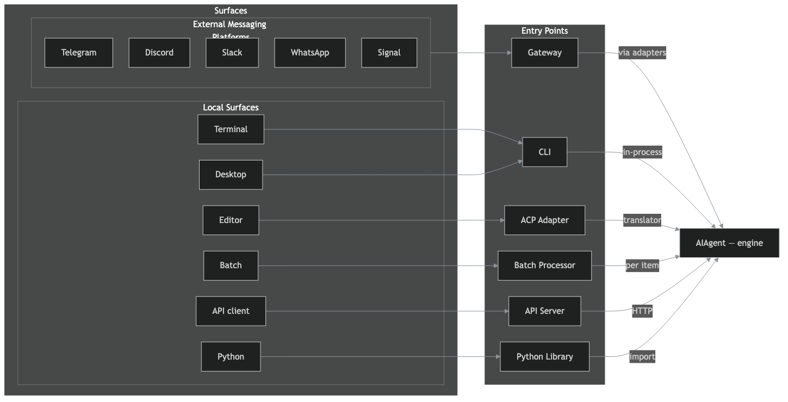

# Hermes Agent — Entry Points and Request Paths

This diagram maps how every interaction surface reaches the AIAgent core — the engine that does the actual reasoning and tool calling. There are six **entry points** (the documented frontends), each connecting directly to the AIAgent. Only messaging platforms route through the Gateway; everything else calls the AIAgent directly.

---

## The Three Layers

| Layer | What it is | Count |
|------|-----------|-------|
| **Surfaces** | What the user (or system) touches | 2 groups, 11 surfaces |
| **Entry Points** | The documented frontends to AIAgent | 6 |
| **AIAgent** | The engine — reasoning + tool calling | 1 |

---

## Surfaces

### External Messaging Platforms

External platforms that live on other companies' servers. They push messages to Hermes via webhooks or long polling. These are the only surfaces that require the Gateway — a persistent background process that receives messages, adapts them, and dispatches to the AIAgent.

| Surface | Input example |
|---------|---------------|
| **Telegram** | "What's the capital of France?" — typed in a Telegram chat |
| **Discord** | "Review this PR" — sent in a Discord channel or DM |
| **Slack** | "Summarize today's standup notes" — posted in a Slack workspace |
| **WhatsApp** | "Remind me to call mom tomorrow" — sent via WhatsApp message |
| **Signal** | "Search the web for AI agent frameworks" — sent in a Signal DM |

**Key term: Adapter.** Each platform has its own adapter inside the Gateway — a translator that converts between the platform's native API (Telegram Bot API, Discord Gateway, Slack Web API) and the AIAgent's call interface. The adapter handles message format, media attachments, threading, typing indicators, and delivery confirmation.

### Local Surfaces

Surfaces that run on your machine and can call the AIAgent directly — no Gateway needed.

| Surface | Input example |
|---------|---------------|
| **Terminal** | `hermes chat -q "What's my disk usage?"` — a command typed in a shell |
| **Desktop** | Drag a file into the desktop app and type "Summarize this PDF" — GUI interaction with drag-and-drop |
| **Editor** | Highlight code in VS Code and ask "Explain what this function does" — IDE-native interaction through the ACP adapter |
| **Batch** | A JSON file with 50 prompts: `{"prompts": ["Summarize doc 1", "Summarize doc 2", ...]}` — processed as a bulk run with no human in the loop |
| **API client** | `curl -X POST http://localhost:8000/v1/chat -d '{"messages": [...]}'` — an HTTP request from any client (script, webhook, another service) |
| **Python** | `from hermes_agent import AIAgent; agent.chat("Debug this error")` — a direct library import and function call in a Python script |

**Key term: In-process.** Local surfaces call the AIAgent directly — either by importing the class (CLI, Python library) or through a local connection (desktop, API server). No broker, no adapter, no translation layer.

---

## Entry Points

The six documented frontends to the AIAgent. Each connects directly to the engine.

| Entry point | Receives from | Connects to AIAgent via | How it calls |
|------------|---------------|------------------------|--------------|
| **Gateway** | External messaging platforms | Platform adapters | One adapter per platform translates the message format and dispatches to `AIAgent.run_conversation()` |
| **CLI** | Terminal, Desktop app | In-process call | Imports `AIAgent` and calls `run_conversation()` directly in the same process |
| **ACP Adapter** | Editor (VS Code, Zed, JetBrains) | Protocol translator | Translates ACP (Agent Client Protocol) messages into AIAgent calls — handles file edits, diffs, approvals |
| **Batch Processor** | Batch runner (CLI, cron, script) | Library call per item | Iterates over a list of prompts and calls `AIAgent` for each one — no human in the loop |
| **API Server** | API client (curl, SDK, webhook) | HTTP handler | Serves an OpenAI-compatible HTTP API — receives requests, calls `AIAgent`, returns JSON responses |
| **Python Library** | Python script | Direct import + call | `from hermes_agent import AIAgent` — the most direct path, no protocol at all |

**Key term: Entry point.** An entry point is a documented frontend to the AIAgent. It's the seam where a surface connects to the engine. Each entry point handles the translation between how the surface sends input and how the AIAgent expects to receive it.

---

## AIAgent

The engine. Every entry point calls the same `AIAgent` class — the same reasoning, the same tool calling, the same session store, the same memory, the same skills. The AIAgent doesn't know or care which surface you're using; it sees the same conversation either way.

**Key term: AIAgent.** The core orchestration engine. It assembles the system prompt, selects the provider, makes the model call, executes tool calls, maintains conversation history, handles compression and fallback, and persists the session. Everything else is a way to get a message to it.

---

## The Key Distinction

**Only messaging platforms route through the Gateway.** Everything else calls the AIAgent directly.

- **External** (Telegram, Discord, Slack, etc.) → needs the Gateway because the platforms live on other servers and push messages to you
- **Local** (CLI, Desktop, Editor, Batch, API, Python) → calls the AIAgent directly because it runs on the same machine

The Gateway is the **broker for external platforms**. It's not a layer between all entry points and the AIAgent — it's specifically the entry point for messaging, with adapters that translate each platform's API into the AIAgent's call interface.

---

*Diagram generated from the official Hermes Agent architecture documentation. Entry points are a flat, independent set — each connecting directly to one AIAgent core.*
