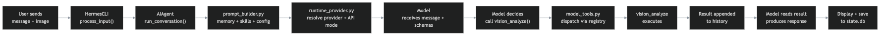

# Vision Analyze — Request Trace

A step-by-step trace of a single tool call (`vision_analyze`) through the Hermes Agent architecture, from user input to session persistence.



---

## The trace

1. **User sends a message with an image attachment** — "Look at this screenshot and tell me what you see." The message includes an image file.

2. **Surface → Entry Point:** The desktop app routes through the CLI entry point. `HermesCLI.process_input()` receives the message.

3. **AIAgent starts:** `HermesCLI.process_input()` calls `AIAgent.run_conversation()` with the user's message.

4. **Prompt builder assembles the system prompt:** `agent/prompt_builder.py` assembles the system prompt from:
   - Memory (`MEMORY.md` + `USER.md`) — frozen snapshot loaded at session start
   - Skills index (Level 0 — names + one-line descriptions of all installed skills)
   - Config (model, provider, active toolsets)
   - Attached media (the image is made available to the model as an attachment)

5. **Provider resolves:** `hermes_cli/runtime_provider.py` resolves to the configured provider and API mode (e.g., `chat_completions`). Credentials are loaded from `.env` / `auth.json`.

6. **Model receives:** The model receives:
   - The user's message (text + image attachment)
   - The assembled system prompt (memory + skills index + config)
   - All available tool schemas (name, description, parameters for every enabled tool — including `vision_analyze`)

7. **Model decides:** The model reads the tool schemas, matches intent to capability — "I need to see this image to answer" → matches the `vision_analyze` tool schema → emits a structured tool call with the image path and a question.

8. **Tool dispatch:** `model_tools.py` receives the structured tool call from the model response. It resolves the handler from `tools/registry.py` (where tools are registered at import time) and invokes the handler with the model's arguments.

9. **Tool executes:** The `vision_analyze` handler loads the image from disk, sends it to a vision-capable model (or the main model if it supports vision), and returns a text description of what it sees.

10. **Result fed back:** The tool result is appended to conversation history as a `{"role": "tool", "content": "..."}` message. This is the **observe** step in the reason → act → observe → reason loop.

11. **Model reads the result:** The model receives the vision analysis text alongside the conversation history. It reasons: "The user showed me a screenshot. The tool told me what's in it. Now I can respond."

12. **Model responds:** The model produces a text response — no further tool calls needed. One loop iteration was sufficient: think, call, run, done.

13. **Response displayed:** The response is rendered in the desktop app via the CLI's display callback.

14. **Session persisted:** The entire turn — user message, tool call, tool result, and assistant response — is saved to `state.db` (SQLite + FTS5) via `hermes_state.py`. The session can be resumed later with `--resume` or `--continue`.

---

## The loop, visualized

```
User message + image
        │
        ▼
┌─ HermesCLI.process_input() ─────────────────────────┐
│                                                      │
│  AIAgent.run_conversation()                         │
│      │                                               │
│      ├── prompt_builder.py assembles system prompt  │
│      │   (memory + skills index + config + image)    │
│      │                                               │
│      ├── runtime_provider.py resolves provider       │
│      │                                               │
│      ├── Model receives: message + prompt + schemas │
│      │                                               │
│      ├── Model decides: call vision_analyze()       │
│      │                      ↓                        │
│      │   model_tools.py dispatches ──┐               │
│      │                                ▼              │
│      │   ┌─ vision_analyze executes ─────────────┐  │
│      │   │  Loads image from disk               │  │
│      │   │  Sends to vision model                │  │
│      │   │  Returns text description             │  │
│      │   └───────────────────────────────────────┘  │
│      │                      ↓                        │
│      ├── Result appended to conversation history    │
│      │                                               │
│      ├── Model reads result, produces response      │
│      │                                               │
│      └── Response returned to CLI ──────────────── │
│                                                      │
└──────────────────────────────────────────────────────┘
        │
        ▼
   Display + save to state.db
```

---

## Key architecture concepts visible in this trace

| Concept | Where it happens | Module reference |
|---|---|---|
| **Entry point** | Desktop app → CLI (`HermesCLI.process_input()`) | Module 3, Module 11 |
| **Prompt assembly** | `agent/prompt_builder.py` — memory, skills, config, image | Module 9, Module 8, Module 4 |
| **Provider resolution** | `runtime_provider.py` — provider + API mode + credentials | Module 4 |
| **Tool schema matching** | Model reads schemas, matches intent to `vision_analyze` | Module 7 |
| **Tool dispatch** | `model_tools.py` → `tools/registry.py` → handler | Module 7 |
| **The loop** | think → call → run → observe → respond (one iteration) | Module 2 (aphorism #6) |
| **Session persistence** | `hermes_state.py` → SQLite + FTS5 | Module 5 |
| **Frozen snapshot** | Memory loaded at session start, not re-read mid-session | Module 9 |

---

*Trace based on the [official Hermes Agent architecture documentation](https://hermes-agent.nousresearch.com/docs/developer-guide/architecture) and [agent-loop internals](https://hermes-agent.nousresearch.com/docs/developer-guide/agent-loop). No personal file paths included.*
